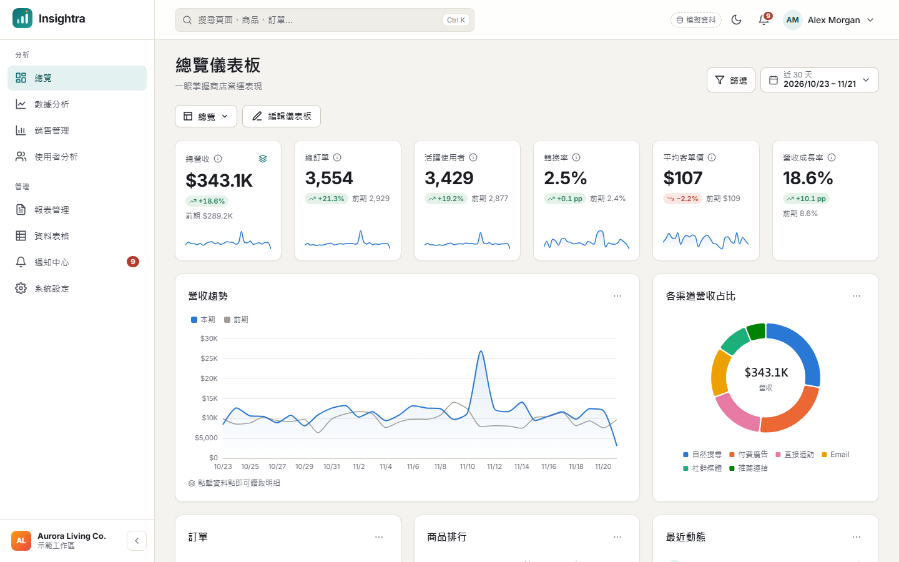
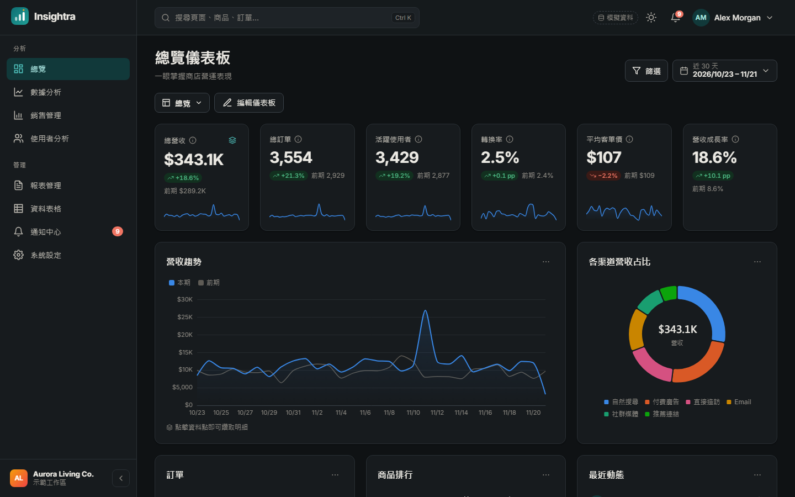
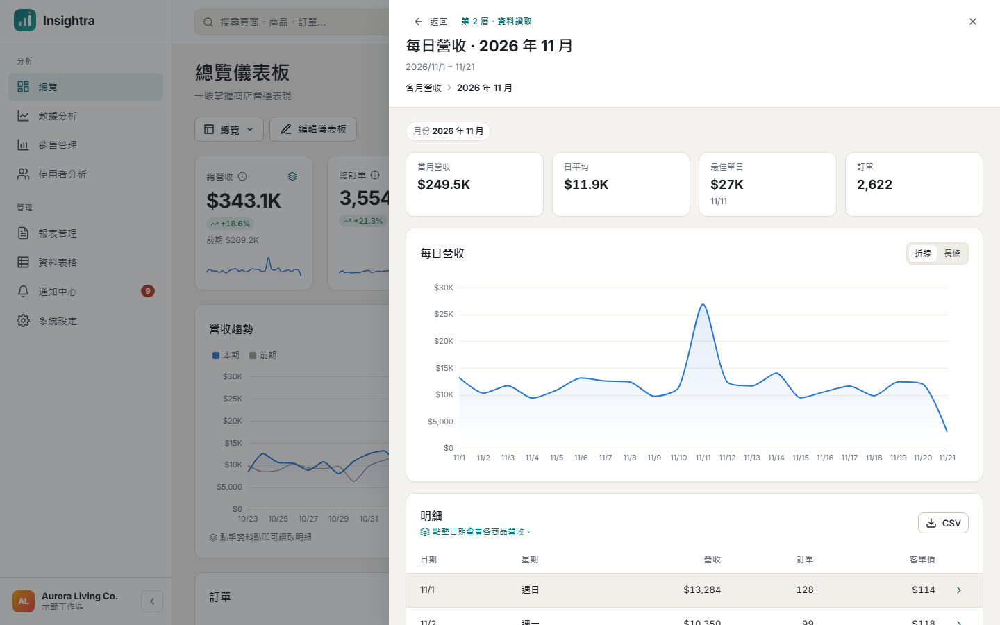
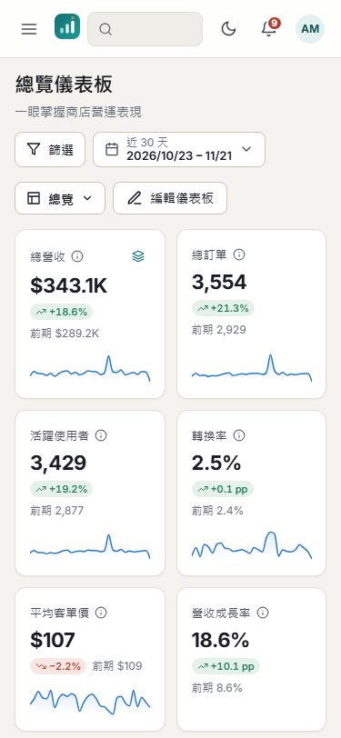

# Insightra — E-commerce Business Intelligence Dashboard

> 以 **Nuxt 3 + Vue 3 + TypeScript + Pinia + ECharts + SCSS** 打造的企業級數據分析 SaaS 作品集專案。
> ⚠️ 畫面上所有數字皆由內建 Mock API 產生，為**模擬資料**，不是真實商業資料。
>
> 🔗 **線上 Demo**：https://insightra-v.vercel.app（登入頁已預填示範帳號）



| Dark mode | Drill-down | Mobile |
| --- | --- | --- |
|  |  |  |

---

## 專案介紹

**Insightra** 是給電商管理者使用的 BI 儀表板（虛構客戶：Aurora Living Co.）。它把流量、訂單、商品、顧客整合在一起，回答：
「這期表現如何、和上一期比如何、營收從哪裡來、異常是哪些商品和訂單造成的」。

這不是靜態畫面：日期與篩選條件會驅動**所有**元件重新計算；任何數字都可以一路鑽取到單筆訂單；儀表板可以自行增減、拖曳、調整大小並保存。

## 核心功能

- **全域日期篩選與跨元件同步**：今日 / 昨日 / 7 / 30 / 90 天 / 本月 / 上月 / 自訂區間；KPI、圖表、排行、表格同步更新；自動與前一個等長期間比較（目前 / 前期 / 差異 / 成長率，正確處理 0、空值、負數）；篩選同步到 URL 與 localStorage。
- **Drill-down 資料鑽取**（3 條流程、9 種層級）：月營收 → 每日 → 商品 → 訂單明細；品類 → 商品排行 → 商品詳情；渠道 → 漏斗與行為。具 Breadcrumb、返回、層級指示、篩選條件、KPI、可切換圖表與明細表。
- **Widget 個人化儀表板**：8 種 Widget；新增 / 移除 / 隱藏 / 拖曳（支援觸控與鍵盤）/ 調整大小 / 個別設定 / 儲存 / 取消 / 還原預設 / 多組版面；Zod 驗證 localStorage。
- **12 種資料視覺化**：折線、面積、長條、堆疊長條、甜甜圈、雷達、散佈、熱力圖、留存 cohort、漏斗、Gauge、Sparkline；Tooltip、Legend 切換、縮放、點擊鑽取、Loading / Empty / Error 狀態、表格替代檢視、色盲安全配色。
- **完整頁面**：Overview、Analytics、Sales、Users、Reports（建立 / 詳細 / CSV / PDF）、Data Table（搜尋、篩選、排序、分頁、欄位顯示、多選、批次、CSV）、Settings、Profile、Notifications、Login、Forgot Password、404。
- **Light / Dark Mode**（含圖表、Tooltip、Modal）、**RWD**（Desktop / Tablet / Mobile）、全域搜尋（Ctrl + K）、Toast、確認 Modal。
- **繁體中文（預設）/ English 全站切換**：介面文字、圖表與表格標題、日期格式（`2026/11/18`、`2026 年 11 月`、週一…週日）、模擬商品名稱，以及 API 回傳的標籤（渠道、品類、漏斗、鑽取、通知）都跟著切換；數字完全不受影響。

## 技術選型

| 類別 | 技術 | 選用理由 |
| --- | --- | --- |
| Framework | Nuxt 3.21（SPA 模式）+ Vue 3.5 | 檔案式路由、自動匯入、內建 Nitro 寫 Mock API |
| 語言 | TypeScript（strict，無 `any`） | API 合約與元件 Props 全型別化 |
| 狀態 | Pinia 3 | 全域篩選、Widget 配置、Drill-down stack |
| 圖表 | ECharts 6（tree-shaken、延遲載入） | 圖表種類完整、事件 API |
| 樣式 | SCSS（7-1 架構）+ CSS 變數 Design Tokens | 主題切換、RWD mixin |
| 驗證 | Zod 4 | API query 與 localStorage 驗證 |
| 拖曳 | vuedraggable（SortableJS） | 觸控支援、直接操作陣列順序 |
| 品質 | ESLint 10、Prettier、Vitest 5、Playwright | |

詳細理由與「刻意不用的套件」見 [`docs/SYSTEM_ARCHITECTURE.md`](docs/SYSTEM_ARCHITECTURE.md)。

## 專案架構

```
insightra/
├── assets/scss/   Design System（abstracts / base / components / layout / utilities）
├── components/    common · layout · forms · charts · tables · dashboard · widgets
├── composables/   useApiQuery · useAnalytics · useDrillDown · useWidgetManager · useDashboard · useDateFilter …
├── stores/        filters · dashboard · drilldown · settings · auth · notifications · reports · ui
├── services/      API client（analytics / orders / drilldown / reports / auth）
├── server/        Nitro Mock API：api/（15 支 endpoint）· mock/（資料產生器）· utils/（聚合引擎）
├── types/         domain · analytics · api · widgets · drilldown · app
├── utils/         date · stats · format · metrics · csv · storage · charts/
├── pages/ layouts/ middleware/ plugins/ locales/ data/
├── design/        tokens.json（可匯入 Figma）· reference/（實際畫面截圖）
├── docs/          12 份技術文件
└── tests/         unit/（Vitest）· e2e/（Playwright）
```

資料流：`Mock Data → 聚合（Totals）→ 統計（deriveMetrics / compareMetric）→ REST API → services → composables（快取、去重）→ 元件 → 圖表 / 表格 / KPI`

## 安裝與啟動

需求：Node.js ≥ 22（開發使用 22.14）、npm ≥ 10。

```bash
npm install          # 安裝相依並產生 Nuxt 型別
npm run dev          # http://localhost:3000（若被占用會自動換埠）
```

登入：**demo@insightra.app / insightra2026**（登入頁已預填）。

### 常用指令
| 指令 | 說明 |
| --- | --- |
| `npm run dev` | 開發伺服器 |
| `npm run build` | Production build（輸出 `.output/`） |
| `npm start` | 執行 production build（`PORT` 可設定，預設 3000） |
| `npm run lint` / `npm run format` | ESLint / Prettier |
| `npm run typecheck` | vue-tsc 型別檢查 |
| `npm test` | 單元測試（Vitest） |
| `npm run test:e2e` | E2E：Chromium / Firefox / WebKit（先 `npm run build`；第一次需 `npx playwright install chromium firefox webkit`） |
| `npm run screenshots` | 對執行中的 build（port 3100）擷取 `design/reference` 截圖 |

> Windows 注意：請在大寫磁碟代號路徑（例如 `E:\...`）執行 Vitest，小寫 `e:\` 可能造成模組重複載入錯誤。

## 環境設定

`.env.example`：
```bash
# 正式後端網址；留空 = 使用內建 Mock API（server/api）
NUXT_PUBLIC_API_BASE=
```

## API 與資料來源

- 內建 **Mock REST API**（Nuxt Nitro）：`/api/analytics/*`、`/api/users/*`、`/api/orders`、`/api/drilldown`、`/api/activity`、`/api/notifications`、`/api/meta`、`/api/auth/*`。
- 資料由 seeded 產生器建立：同一天永遠產生相同資料；訂單數 = 漏斗購買數、每筆訂單對應真實商品與顧客；含成長、季節性、購物節、時段高峰。
- 所有 query 以 Zod 驗證；回應格式 `{ data, meta: { mock: true } }`。
- 報表定義存於 localStorage（與 REST 相同的 async 介面，方便替換）。

完整規格：[`docs/API_DOCUMENTATION.md`](docs/API_DOCUMENTATION.md)、[`docs/DATA_STRUCTURE.md`](docs/DATA_STRUCTURE.md)。

## 測試

| 檢查 | 結果（2026-11-21 本機實測） |
| --- | --- |
| ESLint / TypeScript | 0 errors |
| 單元測試 | 84 / 84 passed |
| E2E（Chromium · Firefox · WebKit 桌機 ＋ Pixel 7 · iPhone 14） | 54 / 54 passed |

`.github/workflows/ci.yml` 會在 push / PR 時跑同樣的檢查（lint → typecheck → 單元測試 → build → 三瀏覽器 E2E）。
此 workflow 尚未在 GitHub 上實際執行過（專案還沒推到 GitHub repository）。

明細見 [`docs/TEST_REPORT.md`](docs/TEST_REPORT.md)。

## 部署

此專案需要 Node 執行環境（Mock API 在 Nitro 伺服器上），**不適用純靜態主機**（如 GitHub Pages）。

- **Vercel / Netlify**：匯入 Git repository，Build command `npm run build`，Nitro 會自動偵測平台 preset。
- **Render / Railway / 任何 Node 主機**：Build `npm install && npm run build`，Start `node .output/server/index.mjs`。
- **Docker**：專案附 `Dockerfile`（multi-stage、`node:22-alpine`、只複製 `.output/`、以非 root 的 `node` 使用者執行）：
  ```bash
  docker build -t insightra .
  docker run -p 3000:3000 insightra
  ```
  （本機未安裝 Docker，此映像檔尚未實際 build 驗證。）

> 目前部署於 **Vercel**：https://insightra-v.vercel.app（匯入 repository、使用預設設定）。
> Mock 資料的「今天」固定以台北時間（`Asia/Taipei`）計算，不受 Vercel 伺服器使用 UTC 影響。

## UI/UX 設計稿

**Design File（Claude Design canvas，可編輯、可 Play 原型）**：https://claude.ai/artifact/EFWVzdVAhzkxwLZyUXQfCf
（預設為私人；要給面試官看，請先在頁面右上 Share 開啟分享）

| Page | 內容 |
| --- | --- |
| 01 專案概述 | 封面與問題定義、設計目標、流程、關鍵決策；人物誌、使用者流程；網站地圖與資料鑽取階層 |
| 02 設計系統 | 基礎規範（淺色 / 深色色票、色盲驗證圖表色、字級、間距、圓角陰影、網格）；元件與各種狀態 |
| 03 線框稿 | 總覽、資料鑽取面板、編輯模式、手機（灰階 + 標註） |
| 04 高保真 桌機與平板 | 登入 → 總覽（可切換深色）→ 資料鑽取四層可點擊原型；深色、資料表格、平板 768 |
| 05 高保真 手機 | 總覽、導覽抽屜、資料卡片、資料鑽取（可點擊） |

設計稿全部使用繁體中文（字體 Inter ＋ Noto Sans TC）。

另外提供 Figma 工作流程用的素材（若面試職缺指定 Figma）：
- [`design/tokens.json`](design/tokens.json)：用 **Tokens Studio for Figma** 匯入，自動建立 Light / Dark Variables
- [`design/reference/`](design/reference)：實作畫面截圖（1440 / 768 / 375）
- [`docs/FIGMA_GUIDE.md`](docs/FIGMA_GUIDE.md)：在 Figma 重建同一套設計的步驟

## 文件

| 文件 | 內容 |
| --- | --- |
| [PRD](docs/PRD.md) | 產品定位、Persona、功能優先級、Sitemap、User Flow、指標定義 |
| [SYSTEM_ARCHITECTURE](docs/SYSTEM_ARCHITECTURE.md) | 技術選型、分層、資料流、SSR/CSR、效能、安全、部署 |
| [UI_UX_GUIDE](docs/UI_UX_GUIDE.md) | 品牌、色彩（含色盲驗證）、字體、間距、狀態、圖表規則、無障礙 |
| [FIGMA_GUIDE](docs/FIGMA_GUIDE.md) | Figma 建構流程與元件對照 |
| [DATA_STRUCTURE](docs/DATA_STRUCTURE.md) | 模擬資料設計、型別、統計規則、持久化 |
| [API_DOCUMENTATION](docs/API_DOCUMENTATION.md) | 所有 endpoint 與串接正式後端清單 |
| [COMPONENT_GUIDE](docs/COMPONENT_GUIDE.md) | 元件規範與 API |
| [DRILL_DOWN_GUIDE](docs/DRILL_DOWN_GUIDE.md) | 鑽取架構 |
| [WIDGET_SYSTEM](docs/WIDGET_SYSTEM.md) | Widget 管理系統 |
| [DEVELOPMENT_LOG](docs/DEVELOPMENT_LOG.md) | 各 Phase 紀錄與問題 |
| [TEST_REPORT](docs/TEST_REPORT.md) | 實際測試結果 |
| [INTERVIEW_GUIDE](docs/INTERVIEW_GUIDE.md) | 面試說明、追問與回答提示 |

## 已知限制

- 資料為模擬、登入為 Mock（非安全機制）。
- 使用者自己輸入的內容（自訂 Widget 標題、儀表板名稱、已儲存的報表）不會被翻譯；切換語言時，已開啟的鑽取路徑文字維持開啟當下的語言，重新開啟即更新。
- 跨瀏覽器測試使用 Playwright 內建的 Firefox / WebKit 引擎，不等同於實機 Safari / iOS 測試。
- 設計稿為 Claude Design canvas（非 Figma 檔）。

## License

作品集用途。產品名稱、品牌與客戶皆為虛構。
